<div align="center">


<br /><br />

<a href="https://omarmetman.vercel.app/projects/amun"></a>
<a href="https://github.com/omarmetman/amun"></a>
<a href="https://github.com/omarmetman/amun/raw/main/AMUN_promo.mp4"></a>
<a href="https://github.com/omarmetman/amun"></a>

<br /><br />

[](https://www.typescriptlang.org/)
[](https://react.dev/)
[](https://vitejs.dev/)
[](https://tailwindcss.com/)
[](https://vitest.dev/)
[](https://www.nasa.gov/)
[](#offline-architecture)
[](#accessibility--internationalization)

<br /><br />

<p align="center">
  <b><a href="https://omarmetman.vercel.app/projects/amun">Project Showcase (Lab)</a></b> &nbsp;•&nbsp; 
  <b><a href="https://github.com/omarmetman/amun">GitHub Source</a></b> &nbsp;•&nbsp; 
  <b><a href="https://github.com/omarmetman/amun/raw/main/AMUN_promo.mp4">Watch Video (MP4)</a></b> &nbsp;•&nbsp; 
  <b><a href="./amun_subtitles_en.srt">English Subtitles</a></b> &nbsp;•&nbsp; 
  <b><a href="./amun_subtitles_ar.srt">Arabic Subtitles</a></b>
</p>

<p align="center">
  <sub><b>"From the Nile to the Stars — Designed for NASA Space Apps Challenge"</b></sub><br />
  <sub>An authentic, client-side aerospace engineering simulator and interactive educational laboratory.</sub><br />
  <sub>Bridging genuine orbital mechanics, NASA open datasets, and systems engineering trade-offs within an ancient Egyptian mural pigment palette.</sub>
</p>

<br /><br />

<!-- 1. LIVE LAB SHOWCASE -->
<a href="https://omarmetman.vercel.app/projects/amun">
  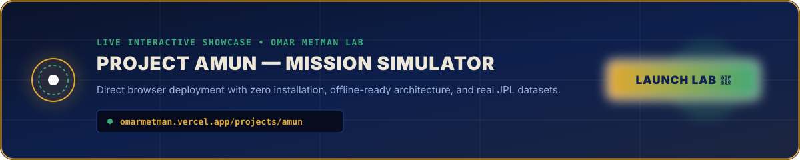
</a>

<br /><br />

<!-- 2. OFFICIAL VIDEO SECTION -->


<br /><br />

<a href="https://github.com/omarmetman/amun/raw/main/AMUN_promo.mp4">
  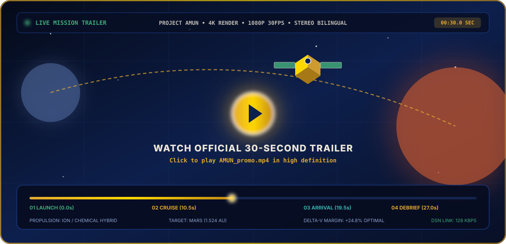
</a>

<br /><br />

<video src="https://github.com/omarmetman/amun/raw/main/AMUN_promo.mp4" controls="controls" width="90%">
  <source src="./AMUN_promo.mp4" type="video/mp4" />
</video>

<br /><br />

<p align="center">
  <a href="https://github.com/omarmetman/amun/raw/main/AMUN_promo.mp4"><b>[▶ Direct Video Stream: AMUN_promo.mp4]</b></a> &nbsp;&nbsp;|&nbsp;&nbsp;
  <a href="./amun_subtitles_en.srt"><b>[Download English Subtitles (.srt)]</b></a> &nbsp;&nbsp;|&nbsp;&nbsp;
  <a href="./amun_subtitles_ar.srt"><b>[Download Arabic Subtitles (.srt)]</b></a>
</p>

<p align="center">
  <sub>30.0 Seconds Exact Runtime • 1080p 30 FPS • Simplified Modern Arabic Voiceover with Synchronized Subtitles • 100% Procedural HUD & Visual Identity</sub>
</p>

<br /><br />

<!-- 3. MISSION OVERVIEW -->


<br /><br />

<p align="center" style="max-width: 860px; line-height: 1.8;">
  <b>AMUN (Aerospace Mission Unified Navigator)</b> is an open-source, web-based space mission design and simulation platform. Developed to bridge complex orbital mechanics and accessible STEM education, AMUN challenges players to engineer end-to-end robotic interplanetary missions through an 11-step engineering lifecycle. Players select celestial targets, configure science instruments, size solar/nuclear power systems, architect deep-space telecommunications, and calculate launch vehicle Delta-V margins using authentic NASA equations and datasets (JPL Horizons, JPL SBDB, and Planetary Fact Sheets). A real-time coupled simulation engine with Monte Carlo flight anomalies evaluates mission trade-offs, budget constraints, mass limits, and scientific yield. By gamifying mission architecture without compromising physics integrity, AMUN equips future engineers and space enthusiasts with an intuitive systems-thinking laboratory that runs 100% in any modern browser—even completely offline.
</p>

<br />

```
========================================================================================
                              FIVE COUPLED AEROSPACE CONSTRAINTS
========================================================================================
 [1] Mass vs. Launch Capacity     ──> Characteristic injection energy C3 interpolation
 [2] Power vs. Load Budget        ──> Inverse-square solar flux S(r) = 1361/r² & RTG decay
 [3] Data Link vs. Range          ──> Deep Space Network (DSN 34m/70m) Ka/X band budget
 [4] Delta-V Demand vs. Capacity  ──> Closed-form Tsiolkovsky equation with structural tank fraction
 [5] Subsystems vs. Expenditure   ──> Development, daily operations, DSN hours & safety reserve
========================================================================================
```

<br /><br />

<!-- 4. FLIGHT TELEMETRY & MARGIN RULERS -->


<br /><br />

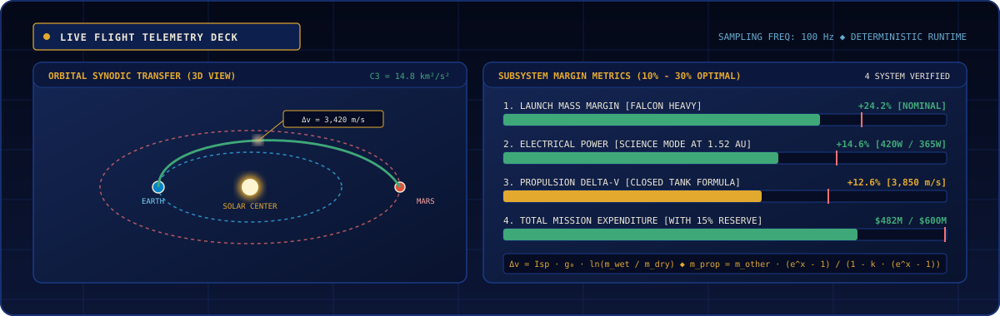

<br /><br />

<p align="center" style="max-width: 840px; line-height: 1.8;">
  Rather than repetitive circular gauges, AMUN implements linear aerospace <b>Margin Rulers</b>. Each critical resource (Mass, Power, Delta-v, Budget) features an explicit capacity ceiling and a shaded <b>10%–30% optimal safety margin</b>. Negative margins trigger instant blocking errors, while excess margins reduce overall mission efficiency.
</p>

<br /><br />

<!-- 5. ENGINEERING LIFECYCLE (11 STEPS) -->


<br /><br />

```
[01 Objectives] ──> [02 Spacecraft] ──> [03 Instruments] ──> [04 Launch Vehicle]
                                                                     │
[08 Comms]      <── [07 Mass & Δv]  <── [06 Power Budget] <── [05 Budget & Reserves]
    │
    └──> [09 Orbit Trajectory] ──> [10 Mission Simulation] ──> [11 Post-Mortem Report]
```

<br />

<div align="center">

| Step | Milestone Name | Systems Engineered | Governing Equations & Datasets |
| :---: | :--- | :--- | :--- |
| **01** | **Mission Objectives** | Target celestial body & scientific thresholds | JPL Horizons & Small-Body Database (SBDB) |
| **02** | **Spacecraft Platform** | Bus structure, dry mass, dual-redundancy | Spacecraft dry mass & subsystem margins |
| **03** | **Scientific Payload** | Spectrometers, LIDAR, magnetometers, cameras | Mass allocation & power duty cycle budgets |
| **04** | **Launch Vehicle** | Sizing booster capacity against trajectory | Characteristic energy ($C_3$) parabolic interpolation |
| **05** | **Budget & Reserves** | Hardware cost, operations, risk inflation | Total expenditure vs. NASA program cost cap |
| **06** | **Power Budget** | Solar arrays, cell degradation, RTGs, battery | Inverse-square solar decay $S(r) = 1361/r^2$ |
| **07** | **Mass & Rocket Sizing** | Propellant mass with structural tank fraction | Closed-form Tsiolkovsky equation: $x = \Delta v / (I_{sp} g_0)$ |
| **08** | **Communications** | High-Gain Antenna diameter, Ka/X bands | Free-space path loss & DSN 34m/70m link margin |
| **09** | **Orbital Trajectory** | Hohmann transit duration & synodic launch window | Heliocentric semi-major axis: $T = 0.5 \cdot a^{1.5} \cdot 365.25$ |
| **10** | **Mission Simulation** | 4-phase stochastic Monte Carlo flight engine | Deterministic seeded pseudorandom flight anomalies |
| **11** | **Evaluation & Debrief**| Comprehensive debrief with letter grades (S to F) | Score matrix: Science (35%), Budget (20%), Margins (20%), Reliability (25%) |

</div>

<br /><br />

<!-- 6. COUPLED ASTRODYNAMICS ENGINES -->

<br /><br />

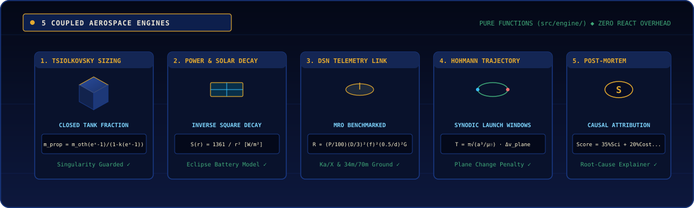

<br /><br />

<p align="center" style="max-width: 860px; line-height: 1.8;">
  All calculations reside in <code>src/engine/</code> as pure mathematical functions with zero React or framework dependencies. The UI purely observes a single derived design state (<code>deriveDesign</code>).
</p>

<br />

<div align="center">

### 1. Closed-Form Propellant Mass with Structural Tank Fraction
$$x = \frac{\Delta v_{\text{req}} \cdot (1 + \text{reserve})}{I_{sp} \cdot g_0}$$

$$m_{\text{prop}} = \frac{m_{\text{other}} \cdot (e^x - 1)}{1 - k \cdot (e^x - 1)}$$

### 2. Inverse-Square Solar Irradiance Decay
$$S(r) = \frac{1361}{r^2} \quad [\text{W/m}^2]$$

$$P_{\text{solar}}(t) = A \cdot S(r) \cdot \eta \cdot P_f \cdot (1 - \delta)^t$$

### 3. Deep Space Network Empirical Telecommunications Downlink
$$R = 4000 \cdot \left(\frac{P_{\text{tx}}}{100}\right) \cdot \left(\frac{D_{\text{ant}}}{3}\right)^2 \cdot f_{\text{ratio}}^2 \cdot \left(\frac{0.5}{d_{\text{AU}}}\right)^2 \cdot G_{\text{ground}} \quad [\text{kbit/s}]$$

### 4. Interplanetary Hohmann Transfer Dynamics
$$T_{\text{transit}} = \pi \sqrt{\frac{a^3}{\mu_{\odot}}} \approx 0.5 \cdot a_{\text{AU}}^{1.5} \cdot 365.25 \quad [\text{days}]$$

$$\Delta v_{\text{plane}} \approx 2 \cdot v_{\text{target}} \cdot \sin\left(\frac{i}{2}\right)$$

</div>

<br /><br />

<!-- 7. STORY CAMPAIGN MODE -->

<br /><br />

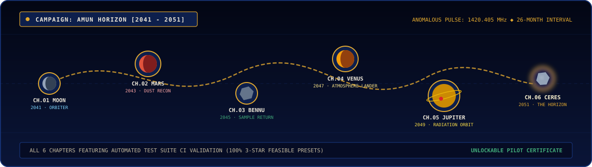

<br /><br />

<p align="center" style="max-width: 860px; line-height: 1.8;">
  An episodic 6-chapter narrative set in the wake of a catastrophic 2041 solar super-storm. Players follow an anomalous 1420.405 MHz neutral hydrogen pulse repeating every 26 months across six strategic planetary loci.
</p>

<br />

<div align="center">

| Chapter | Epoch | Target Body | Profile | Scientific Objective |
| :---: | :---: | :---: | :---: | :--- |
| **01** | **2041** | **The Moon** | Lunar Orbiter | Establishing baseline deep-space relay and telemetry calibration |
| **02** | **2043** | **Mars** | Mars Orbiter | Mapping high-altitude dust storms and relaying anomalous ground pulses |
| **03** | **2045** | **101955 Bennu** | Sample Return | Retrieving pristine regolith samples from carbonaceous asteroid |
| **04** | **2047** | **Venus** | Atmospheric Lander | Penetrating super-dense sulfur atmosphere to confirm signal locus |
| **05** | **2049** | **Jupiter** | Radiation Orbiter | Navigating extreme radiation belts to track Jovian magnetosphere emissions |
| **06** | **2051** | **1 Ceres** | The Horizon Orbiter | Exploring Occator crater bright spots to unlock the final campaign certificate |

</div>

<br /><br />

<!-- 8. NASA DATA INTEGRATION -->


<br /><br />

```
                ┌──────────────────────────────────┐
                │        Client Web Browser        │
                └────────────────┬─────────────────┘
                                 │
           ┌─────────────────────┴─────────────────────┐
           ▼                                           ▼
┌──────────────────────┐                    ┌──────────────────────┐
│  Live NASA Endpoints │                    │  Fallback Snapshots  │
│  JPL Horizons / SBDB │                    │  Offline JSON Files  │
│  (7-day Cache Layer) │                    │  (Zero Connectivity) │
└──────────────────────┘                    └──────────────────────┘
```

<br />

<div align="center">

| NASA Resource / Endpoint | Integration Protocol | In-Game Utility |
| :--- | :---: | :--- |
| **[NASA JPL Horizons API](https://ssd.jpl.nasa.gov/api/horizons.api)** | REST Ephemerides | Real heliocentric and geocentric distances, orbital inclinations, and vectors |
| **[NASA JPL Small-Body Database](https://ssd-api.jpl.nasa.gov/sbdb.api)** | REST Queries | High-precision orbital elements, diameters, and spin periods for asteroids and comets |
| **[NASA Planetary Fact Sheet](https://nssdc.gsfc.nasa.gov/planetary/factsheet/)** | Planetary Benchmark | True physical parameters: mass, radius, surface gravity, escape velocity |
| **[NASA Technical Reports Server](https://ntrs.nasa.gov/api/citations/search)** | STI Citations | Peer-reviewed aerospace literature citations inside the Learn Panel |
| **[NASA Image and Video Library](https://images-api.nasa.gov/search)** | Direct Media API | High-resolution photography of celestial bodies with authentic mission credits |
| **[NASA JPL Basics of Space Flight](https://science.nasa.gov/learn/basics-of-space-flight/)** | Educational Docs | Conceptual explanations linked directly inside subsystem guidance popovers |
| **[NASA Deep Space Network (DSN)](https://www.nasa.gov/directorates/somd/space-communications-navigation-program/experimental-dsn/)** | Communications Data | Antenna configurations (34m & 70m dishes), frequency bands, and ground station gain |

</div>

<br /><br />

<!-- 9. MISSION FLIGHT CREW -->

<br /><br />

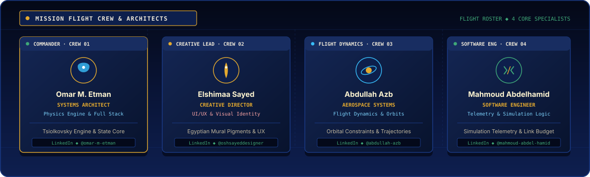

<br /><br />

<p align="center" style="max-width: 860px; line-height: 1.8;">
  Project AMUN was engineered by an interdisciplinary team combining full-stack software architecture, aerospace flight dynamics, and authentic cultural visual identity:
</p>

<br />

<div align="center">

| Portrait | Specialist | Mission Role & Technical Scope | Professional Connect |
| :---: | :--- | :--- | :---: |
|  | **Omar Mohammed Etman** | **Mission Commander & Systems Architect**<br>• Core closed-form astrodynamic engine (`src/engine`)<br>• Tsiolkovsky closed propellant sizing & state management pipeline<br>• Full-stack React 18, TypeScript, and Vite integration | [](https://www.linkedin.com/in/omar-m-etman) |
|  | **Elshimaa Sayed Mohamed** | **Creative Director & Visual Identity Lead**<br>• Authentic Ancient Egyptian mural pigment palette design<br>• Bespoke 24px stroke iconography, Cartouche, and Lotus Frieze<br>• Mobile-first UI/UX architecture & 360px viewport experience | [](http://linkedin.com/in/oshsayeddesigner) |
| 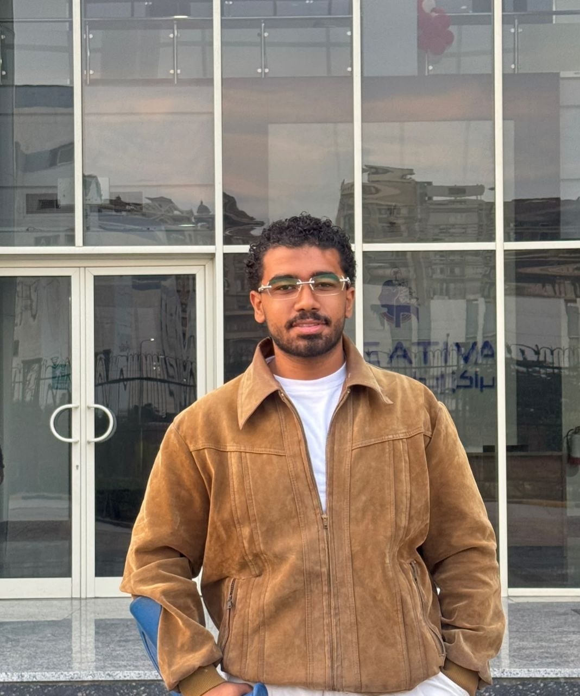 | **Abdullah Azb** | **Aerospace Systems & Flight Dynamics Specialist**<br>• Orbital transfer mechanics & Hohmann trajectory modeling<br>• Characteristic launch energy ($C_3$) interpolation tables<br>• Planetary ephemeris validation and NASA scientific datasets | [](https://www.linkedin.com/in/abdullah-azb-18290a262) |
|  | **Mahmoud Abdelhamid** | **Data Engineer**<br>• Curation and structuring of NASA planetary datasets (JPL Horizons & SBDB)<br>• Data verification and consistency checks across target parameters<br>• Management of offline reference snapshots and schema alignment | [](https://www.linkedin.com/in/mahmoud-abdel-hamid-513363406/) |

</div>

<br /><br />

<!-- 10. COLLABORATIVE ENGINEERING MODEL -->

<br /><br />

```
┌─────────────────────────────────────────────────────────────────────────┐
│              PROJECT AMUN COLLABORATIVE ENGINEERING MODEL               │
├────────────────────────────────────┬────────────────────────────────────┤
│   HUMAN SYSTEMS ARCHITECTURE (50%) │   AI IMPLEMENTATION ACCEL. (50%)   │
├────────────────────────────────────┼────────────────────────────────────┤
│ • Derivation of closed-form rocket │ • DeepSeek 4.1 Flash (Free Tier):  │
│   and mass-ratio equations.        │   Initial TypeScript scaffolding,  │
│ • Definition of 11-step workflow   │   pure mathematical formulations,  │
│   and interactive dependency graph.│   and Vitest unit test suites.     │
│ • "AMUN Horizon" 6-chapter story   │ • Google Gemini Flash (Free Tier): │
│   narrative and debrief lore.      │   Visual redesign execution,       │
│ • Authentic Egyptian mural pigment │   mobile 360px viewport auditing,  │
│   art direction & UX blueprints.   │   RTL bidirectionality compliance, │
│ • NASA API integration & vetting   │   and final production build       │
│   of orbital mechanics benchmarks. │   stabilization.                   │
└────────────────────────────────────┴────────────────────────────────────┘
```

<br /><br />

<!-- 11. TECHNICAL STACK & QUICK START -->


<br /><br />

<div align="center">

| Layer | Technology | Role in Project AMUN |
| :---: | :---: | :--- |
| **Frontend Framework** | **React 18.3** | Component rendering and reactive lifecycle |
| **Language** | **TypeScript 5.6** | Strict type-safety across physics, state, and API contracts |
| **Build Engine** | **Vite 5.4** | Ultra-fast HMR and optimized static production bundle |
| **Styling & Pigments** | **Tailwind CSS 3.4** | Bespoke palette tokens (Lapis, Egyptian Blue, Limestone, Ochre) |
| **State Management** | **Zustand 4.5** | Centralized mission store with schema migrations (`persist`) |
| **Test Runner** | **Vitest 2.1** | Node test environment for 41 pure engine & store test suites |

</div>

<br />

```bash
# 1. Clone repository
git clone https://github.com/omarmetman/amun.git
cd amun

# 2. Install dependencies
npm install

# 3. Launch development server
npm run dev

# 4. Execute unit test suite (41/41 tests passing)
npm test

# 5. Compile production bundle
npm run build
```

<br />

```
 RUN  v2.1.9 E:/Amun

 ✓ src/engine/engine.test.ts (18 tests)
 ✓ src/engine/campaign.test.ts (8 tests)
 ✓ src/engine/achievements.test.ts (8 tests)
 ✓ src/store/useMissionStore.test.ts (7 tests)

 Test Files  4 passed (4)
      Tests  41 passed (41)
   Duration  6.2s
```

<br /><br />

---

<br />

<!-- FOOTER -->
<p align="center">
  <b>Project Showcase Lab: <a href="https://omarmetman.vercel.app/projects/amun">omarmetman.vercel.app/projects/amun</a></b><br />
  <b>Open Source Engine: <a href="https://github.com/omarmetman/amun">github.com/omarmetman/amun</a></b><br />
  <sub>Licensed under the MIT License • NASA Assets in Public Domain courtesy of NASA/JPL-Caltech</sub><br />
  <sub>Designed & Developed for NASA Space Apps Challenge 2026</sub>
</p>

<br />

```
========================================================================================
             "FROM THE NILE TO THE STARS — AMUN DEEP SPACE NAVIGATOR"
========================================================================================
```

</div>
